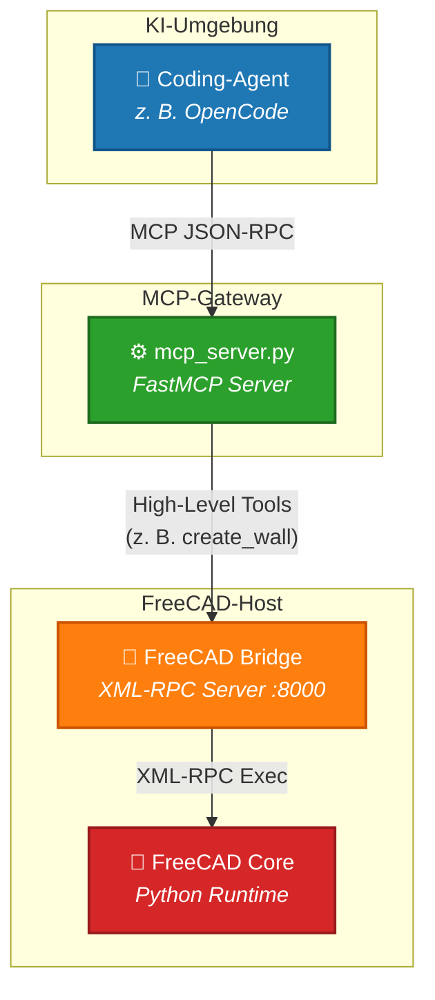

<div align="center">

# 🏛️ freecad-bim-agent

### **Die intelligente Schnittstelle zwischen KI-Agenten & FreeCAD**

*Ermöglicht KI-Coding-Agenten das Designen, Parametrisieren und Analysieren von 3D-BIM-Modellen direkt in FreeCAD.*

[](LICENSE)
[](https://www.python.org/)
[](https://modelcontextprotocol.io/)
[](https://www.freecad.org/)
[](https://opencode.ai/)

---

[English](README.md) • [Deutsch](README.de.md) • [Dokumentation](#-api--werkzeug-referenz) • [Fehler melden](https://github.com/ascriba/freecad-bim-agent/issues)

</div>

<br />

## 🌟 Übersicht

**freecad-bim-agent** ist ein leistungsstarker Server auf Basis des **Model Context Protocol (MCP)**, entwickelt mit dem FastMCP-Framework. Er dient als autonome Schnittstelle zwischen KI-Sprachmodellen / Coding-Agenten (wie [OpenCode](https://opencode.ai/)) und **FreeCAD**.

Durch die Verknüpfung von High-Level-LLM-Befehlen mit der internen Python-API von FreeCAD über eine XML-RPC-Brücke ermöglicht dieser Server KI-Agenten das **Erstellen, Bearbeiten, Überprüfen und visuelle Validieren komplexer 3D-Geometrien sowie IFC-konformer BIM-Strukturen** in Echtzeit.

---

## 🏗️ Systemarchitektur

Die Architektur verbindet standardisierte KI-Agenten-Aufrufe direkt mit der lokalen FreeCAD Python-Laufzeitumgebung:



---

## ✨ Hauptmerkmale

- 🤖 **Agent-First Design:** Für autonome Agenten (z. B. OpenCode) optimierte Schemata und Rückgabeformate.
- 📐 **Parametrische CSG-Modellierung:** Erstellung von Grundkörpern (Würfel, Zylinder, Kugel) mit nativer Einheitenunterstützung (`mm`, `cm`, `m`).
- 🏢 **Fortgeschrittene BIM-Werkzeuge:** IFC-konforme Gebäudestrukturen (Gelände, Gebäude, Geschosse, Wände, Decken, Dächer, Treppen).
- 🚪 **Automatische Öffnungen & Ausrichtung:** Intelligente Wandausrichtung (Innen-/Außenkante) und präzises Einsetzen von Fenstern und Türen.
- 📐 **Draft & 2D-Dokumentation:** Erstellen von Linien, Polylinien, Maßen, Kreisen und Texten im 3D-Raum.
- 👁️ **Visuelles Feedback:** Generiert Screenshots (Base64/PNG) des 3D-Ansichtsfensters zur visuellen Validierung durch das KI-Modell.
- 🔍 **Validierung & Qualitätskontrolle:** Automatische Prüfungen auf Geometriefehler, Bounding-Box-Überschneidungen und fehlende IFC-Daten.
- ⚡ **Batch-Operationen:** Bündelwerkzeuge wie `add_to_container_batch` reduzieren die Anzahl der Werkzeugaufrufe erheblich.
- 🔓 **Python-Fallback (`execute_python`):** Flexibler Notfallpfad zur Ausführung von direktem Python-Code in FreeCAD bei hochspezifischen Aufgaben.

---

## ⚠️ Wichtiger Sicherheitshinweis (`execute_python`)

> [!WARNING]  
> Das Werkzeug `execute_python` gibt dem Agenten die Möglichkeit, beliebigen Python-Code mit den vollen Rechten des lokalen FreeCAD-Benutzers auszuführen.

- **Sicherheitsrisiken:** Unbefugter Dateizugriff, Systembefehle oder unerwünschtes Verhalten bei unvorhersehbaren Antworten des LLM.
- **Sicherheitsabfrage:** Beim Laden der Brücke fordert ein **Qt-Bestätigungsdialog** (oder Konsolen-Prompt) explizit eine Erlaubnis an. Wird diese abgelehnt, bleibt `execute_python` blockiert, bis FreeCAD neu gestartet wird.

---

## 🚀 Schnellstart

### 1. Voraussetzungen

- **Python:** 3.10 oder höher
- **FreeCAD:** 1.0 oder höher. Eine Instanz mit laufender **FreeCAD Bridge** (XML-RPC-Server auf Port 8000).
- **MCP-Client:** Ein MCP-kompatibler Agent (getestet mit [OpenCode](https://opencode.ai/)).

> **Snap-Installation:** Ein per Snap installiertes FreeCAD kann `/tmp` nicht
> lesen. Klone in diesem Fall in dein Benutzerverzeichnis (`~/freecad-bim-agent`),
> nicht nach `/tmp`.

### 2. Installation

```bash
git clone https://github.com/ascriba/freecad-bim-agent.git
cd freecad-bim-agent
pip install -r requirements.txt
```

### 3. Bridge in FreeCAD starten

FreeCAD öffnen, zur **Python-Konsole** wechseln (View → Panels → Python console)
und ausführen:

```python
exec(open("/vollstaendiger/pfad/zu/freecad_bridge.py").read())
start_bridge()
```

Die Antwort lautet `--- Bridge AKTIV ---`. Port 8000 muss frei sein.

### 4. MCP-Server starten

In einem zweiten Terminal:

```bash
python mcp_server.py
```

### 5. Agenten-Konfiguration

Füge den Server zur MCP-Konfigurationsdatei deines Agenten hinzu (z. B. `opencode.json`):

```json
{
  "mcp": {
    "FreeCAD": {
      "type": "local",
      "command": [
        "/path/to/freecad-bim-agent/.venv/bin/python3",
        "/path/to/freecad-bim-agent/mcp_server.py"
      ],
      "enabled": true
    }
  }
}
```

### Tests ausführen

```bash
bash run_tests.sh
```

Die Suite startet FreeCAD headless (ohne GUI) und meldet `PASS`/`FAIL` pro
Test sowie eine Zusammenfassung. Der Exit-Code ist nur dann `0`, wenn alle
Tests bestehen.

Falls FreeCAD nicht im `PATH` liegt, `FREECAD_CMD` setzen:

```bash
FREECAD_CMD=/usr/bin/freecadcmd bash run_tests.sh
```

---

## 🛠️ API & Werkzeug-Referenz

<details>
<summary><b>1. Grundkonstruktion & Transformationen (CSG)</b></summary>

| Werkzeug | Argumente | Beschreibung |
| :--- | :--- | :--- |
| `create_cube` | `length`, `width`, `height` | Erstellt einen parametrischen Quader (unterstützt Einheiten-Strings). |
| `create_cylinder` | `radius`, `height` | Erstellt einen Zylinder. |
| `create_sphere` | `radius` | Erstellt eine Kugel. |
| `set_position` | `name`, `x`, `y`, `z` | Verschiebt ein Objekt an eine absolute Koordinate (in Metern). |
| `move_by` | `name`, `dx`, `dy`, `dz` | Verschiebt ein Objekt RELATIV um einen Offset (in Metern). |
| `rotate_object` | `name`, `axis`, `angle` | Dreht ein Objekt um die angegebene Achse (Grad). |
| `clone_object` | `source_name`, `new_name` | Erstellt einen parametrischen Draft-Klon. |
| `mirror_object` | `source_name`, `axis`, `origin_x/y/z`, `new_name` | Spiegelt ein Objekt an einer definierten Achsenebene. |

</details>

<details>
<summary><b>2. Boolesche Operationen & Modifikatoren</b></summary>

| Werkzeug | Argumente | Beschreibung |
| :--- | :--- | :--- |
| `boolean_union` | `obj_a`, `obj_b` | Verschmilzt zwei Objekte miteinander. |
| `boolean_cut` | `base_obj`, `tool_obj` | Subtrahiert `tool_obj` von `base_obj`. |
| `boolean_cut_finalize` | `cut_result`, `new_label`, `container`, `hide_sources` | Finalisiert einen Schnitt: Benennt um, blendet Quelle aus, ordnet Geschoss zu. |
| `fillet` | `object_name`, `radius`, `edge_indices` | Verrundet Kanten eines Objekts. |
| `chamfer` | `object_name`, `length`, `edge_indices` | Fasst Kanten eines Objekts an. |

</details>

<details>
<summary><b>3. BIM & Architektur (Arch/BIM Workbench)</b></summary>

| Werkzeug | Argumente | Beschreibung |
| :--- | :--- | :--- |
| `create_site` | `name` | Erstellt ein Baugrundstück (Arch Site). |
| `create_building` | `name` | Erstellt eine Gebäudestruktur (Arch Building). |
| `create_floor` | `name` | Erstellt ein Stockwerk/Geschoss (Arch Floor). |
| `add_to_container` | `object_name`, `container_name` | Ordnet ein Objekt hierarchisch zu (z. B. Wand in Geschoss). |
| `add_to_container_batch` | `object_names`, `container_name` | Ordnet mehrere Objekte gleichzeitig einem Container zu. |
| `create_slab` | `length`, `width`, `height`, `name`, `placement_x/y/z`, `direction` | Erstellt eine Boden- oder Deckenplatte (`direction="-z"` oder `"+z"`). |
| `create_slab_with_openings` | *Slab-Parameter* + `openings`, `direction` | Erstellt eine Deckenplatte mit vordefinierten Öffnungen. |
| `create_wall` | `p1`, `p2`, `width`, `height`, `name`, `align`, `align_to` | Erstellt eine gerade Wand zwischen zwei 3D-Punkten (in Metern). |
| `join_walls` | `walls` | Verbindet mehrere Wände zu einem Objekt. |
| `add_to_wall` | `wall_name`, `component_name` | Setzt ein Fenster/eine Tür in eine Wand ein (Host-Beziehung). |
| `align_wall` | `wall_name`, `align`, `align_to` | Richtet die Wand relativ zu ihrer Basislinie aus. |
| `align_walls_in_container` | `container`, `ref_at` | Richtet alle Wände eines Geschosses automatisch nach Himmelsrichtungen aus. |
| `set_wall_alignment` | `wall`, `ref_at_outside` | Verschiebt die Referenzlinie an die Außenkante und passt die Ausrichtung an. |
| `create_window` | `wall_ident`, `distance_from_start`, `width`, `height`, `sill_height`, `windowtype`, `name` | Fügt ein Fenster/Tür ein und schneidet die Wandöffnung automatisch aus. |
| `create_window_sketch` | `wall_ident`, `width`, `height`, `sill_height`, `name` | Erstellt ein benutzerdefiniertes Fenster basierend auf einer Skizze. |
| `create_roof` | `basewire`, `overhang`, `thickness`, `angle`, `name` | Erzeugt ein Dach aus einem geschlossenen Polygon. |
| `create_stairs` | `height`, `width`, `landing`, `name` | Erstellt eine parametrische Treppe (Arch Stairs). |
| `create_opening` | `base_object`, `shape`, `position`, `size`, `name` | Erstellt eine Aussparung in einem Bauteil via Booleschem Schnitt. |
| `copy_to_floor` | `source_walls`, `target_floor`, `z_offset`, `x_extension` | Kopiert Wände mit Höhenversatz in ein anderes Geschoss. |
| `create_attika` | `roof_slab`, `height`, `thickness`, `offset`, `name_prefix` | Generiert automatisch Attikawände entlang einer Dachplatte. |
| `create_space` | `base_object`, `name` | Erstellt einen Raum (Arch Space) aus einem Festkörper oder Volumen. |
| `add_space_boundary` | `space_name`, `object_name`, `faces` | Fügt Begrenzungsflächen zu einem Raum hinzu. |
| `remove_space_boundary` | `space_name`, `object_name`, `faces` | Entfernt Begrenzungsflächen aus einem Raum. |

</details>

<details>
<summary><b>4. Achsen & Schnittebenen</b></summary>

| Werkzeug | Argumente | Beschreibung |
| :--- | :--- | :--- |
| `create_axis` | *Abstände, Anzahl, visuelle Optionen* | Erstellt parametrische Rasterachsen (Arch Axis). |
| `create_axes` | `axes` (Liste von Dicts) | Bündelerstellung mehrerer Rasterachsen. |
| `create_axis_system` | `axes`, `name` | Gruppiert mehrere Achsen zu einem Achssystem. |
| `create_section_plane` | `x`, `y`, `z`, `direction`, `name` | Erstellt eine Schnittebene für Grundrisse und Ansichten. |

</details>

<details>
<summary><b>5. TGA / MEP & Tragwerk</b></summary>

| Werkzeug | Argumente | Beschreibung |
| :--- | :--- | :--- |
| `create_structure` | `length`, `width`, `height`, `name`, `position_x/y/z` | Erstellt Tragwerkselemente wie Träger oder Stützen. |
| `create_profiled_structure` | `profile_name`, `height`, `name`, `category`, `position_x/y/z` | Tragwerkselement mit Stahlprofil (IPE, HEA, HEB, CHS, UPE etc.). |
| `create_panel` | `length`, `width`, `thickness`, `name` | Erstellt ein Paneel (Arch Panel). |
| `create_curtain_wall` | `basewire`, `panel_width`, `panel_height`, `name` | Erstellt eine Glas-Fassadenwand entlang eines Pfades. |
| `create_pipe` | `basewire`, `outer_diameter`, `wall_thickness`, `name` | Erstellt ein Rohrsystem entlang eines 3D-Pfades. |
| `create_duct` | `basewire`, `width`, `height`, `name` | Erstellt einen rechteckigen Lüftungskanal. |

</details>

<details>
<summary><b>6. Draft (2D-Zeichnen & Anmerkungen)</b></summary>

| Werkzeug | Argumente | Beschreibung |
| :--- | :--- | :--- |
| `create_point` | `x`, `y`, `z`, `name` | Erstellt einen Referenzpunkt. |
| `create_line` | `p1`, `p2`, `name` | Erstellt eine Draft-Linie im 3D-Raum. |
| `move_line` | `line`, `start`, `end` | Verschiebt Start- und Endpunkte einer Linie. |
| `create_polyline` | `points`, `closed`, `name` | Erstellt einen offenen oder geschlossenen Linienzug. |
| `create_rectangle` | `length`, `width`, `placement_x/y/z` | Erstellt ein flaches Rechteck. |
| `create_circle` | `radius`, `placement_x/y/z` | Erstellt einen Draft-Kreis. |
| `create_arc` | `center_x/y/z`, `radius`, `start_angle`, `end_angle` | Erstellt einen Kreisbogen. |
| `create_text` | `text`, `x`, `y`, `z`, `font_size`, `name` | Platziert Text im 3D-Raum. |
| `create_dimension` | `p1`, `p2`, `p3`, `name` | Erstellt eine Maßlinie zwischen zwei Punkten. |

</details>

<details>
<summary><b>7. Daten, IFC-Verwaltung & Export</b></summary>

| Werkzeug | Argumente | Beschreibung |
| :--- | :--- | :--- |
| `set_ifc_data` | `object_name`, `properties_json` | Weist Objekten benutzerdefinierte IFC-Eigenschaften (Psets) zu. |
| `set_ifc_type` | `object_name`, `ifc_type` | Setzt den IFC-Typ eines Objekts mit Enum-Validierung. |
| `set_material` | `object_name`, `material_name`, `color_rgb` | Weist Material und Darstellungsfarbe (RGB) zu. |
| `set_material_batch` | `object_names`, `material_name`, `color_rgb` | Weist mehreren Objekten gleichzeitig dasselbe Material zu. |
| `get_quantities` | `object_name` | Berechnet Massen/Mengen aus der Geometrie (Volumen, Fläche, BBox). |
| `export_ifc` | `file_path` | Exportiert das gesamte Modell als standardisierte IFC-Datei. |
| `analyze_ifc` | `file_path` | Analysiert eine externe IFC-Datei und liefert Projektstatistiken. |
| `create_schedule` | `object_type`, `properties`, `name` | Erstellt eine automatisierte Bauteilliste (Arch Schedule). |
| `create_2d_view` | `source_name`, `direction`, `name` | Generiert eine TechDraw 2D-Projektion (Grundriss / Schnitt). |
| `export_dxf` / `import_dxf` | `file_path` | Exportiert/Importiert CAD-Daten im DXF-Format. |
| `export_pdf` / `export_svg` | `file_path` | Exportiert TechDraw-Blätter als Vektorgrafik oder PDF. |

</details>

<details>
<summary><b>8. Administration, Validierung & Diagnose</b></summary>

| Werkzeug | Argumente | Beschreibung |
| :--- | :--- | :--- |
| `list_objects` | *keine* | Gibt eine Liste aller Objekte mit Zuordnung von Label zu Name zurück. |
| `get_object_info` | `object_name` | Liefert detaillierte Metadaten (Typ, BoundingBox, Status, Volumen). |
| `rename_object` | `object`, `new_label` | Ändert die sichtbare Bezeichnung eines Objekts. |
| `set_visibility` | `object`, `visible` | Schaltet die Sichtbarkeit im 3D-Ansichtsfenster um. |
| `delete_object` | `name` | Löscht ein Objekt dauerhaft aus dem Dokument. |
| `capture_view` | `view_type` (`iso`/`top`/`front`/`right`) | **Gibt PNG-Bild zurück.** Erstellt einen Screenshot der Ansicht. |
| `validate_model` | *keine* | Prüft das Modell auf Fehler, Kollisionen und ungültige Geometrien. |
| `validate_ifc_export` | *keine* | Vorabprüfung auf fehlende IFC-Daten/Materialien vor dem Export. |
| `recompute` | `object_name` (optional) | Berechnet das Dokument oder ein einzelnes Objekt neu. |
| `save_document` | `path` (optional) | Speichert das aktive Dokument als `.FCStd`. |
| `execute_python` | `script` | Führt nativen Python-Code direkt im FreeCAD-Kontext aus. |

</details>

---

## 🛠️ Entwickler- & Architekturhinweise

- **Testsuite ausführen:** `bash run_tests.sh` startet FreeCAD headless und führt alle 96 Tests aus. Die Tests laufen in FreeCADs eigenem Interpreter, weil sie das globale `App`-Objekt brauchen — ein normaler `pytest`-Aufruf funktioniert nicht.
- **Fehlertoleranz:** Jeder XML-RPC-Aufruf ist in Exception-Handler eingebettet. Schlagen FreeCAD-Geometrieoperationen fehl, werden die Fehler in lesbaren Klartext umgewandelt und an das LLM zurückgemeldet. Dadurch bleibt der MCP-Server stabil und der KI-Agent kann Fehler selbstständig korrigieren.
- **Multimodale visuelle Prüfung:** Das Werkzeug `capture_view` empfängt Bilddaten aus FreeCAD, konvertiert sie via `FastMCP.Image` und stellt sie dem Sprachmodell direkt als Bild zur visuellen Überprüfung bereit.
- **Automatische Wiederholungen:** Integrierte Retry-Mechanismen (`_dispatch`) fangen vorübergehende Zeitüberschreitungen ab (2 Versuche, 45s Timeout).

---

## 📄 Lizenz

Lizenziert unter der **MIT-Lizenz**. Siehe [`LICENSE`](LICENSE) für weitere Informationen.

---

<div align="center">
  <sub>Entwickelt für KI-gestützte CAD- & BIM-Workflows.</sub>
</div>