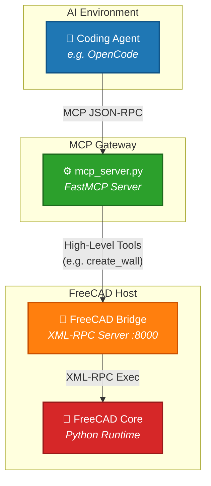

<div align="center">

# 🏛️ freecad-bim-agent

### **The Intelligent Bridge Between AI Agents & FreeCAD**

*Empowering AI Coding Agents to Design, Parametrize, and Analyze 3D BIM Models Directly in FreeCAD.*

[](LICENSE)
[](https://www.python.org/)
[](https://modelcontextprotocol.io/)
[](https://www.freecad.org/)
[](https://opencode.ai/)

---

[English](README.md) • [Deutsch](README.de.md) • [Documentation](#-api--tool-reference) • [Report Bug](https://github.com/your-repo/freecad-bim-agent/issues)

</div>

<br />

## 🌟 Overview

**freecad-bim-agent** is a powerful **Model Context Protocol (MCP)** server built on the FastMCP framework. It acts as an autonomous interface between AI Language Models / Coding Agents (like [OpenCode](https://opencode.ai/)) and **FreeCAD**.

By bridging high-level LLM commands with FreeCAD’s internal Python API via an XML-RPC bridge, this server enables AI agents to **generate, edit, inspect, and visually verify complex 3D parametric geometry and IFC-compliant BIM structures** in real-time.

---

## 🏗️ System Architecture

The architecture connects standardized AI agent calls down to the native FreeCAD Python runtime:



---

## ✨ Key Features

- 🤖 **Agent-First Design:** Optimized schemas and return types tailored for autonomous agents (e.g., OpenCode).
- 📐 **Parametric CSG:** Create cubes, cylinders, and spheres with native unit handling (`mm`, `cm`, `m`).
- 🏢 **Advanced BIM Tools:** Full IFC-compliant structures (Sites, Buildings, Floors, Walls, Slabs, Roofs, Stairs).
- 🚪 **Smart Openings & Placement:** Wall alignment (inside/outside edge) and automated window/door cutout generation.
- 📐 **Draft & 2D Documentation:** Lines, polylines, dimensions, circles, and text in 3D space.
- 👁️ **Visual Feedback:** Captures 3D viewport screenshots (Base64/PNG) so the AI agent can visually inspect its work.
- 🔍 **Validation & Quality Control:** Automated preflight checks for geometric errors, overlapping bounding boxes, and missing IFC data.
- ⚡ **Batch Operations:** Tools like `add_to_container_batch` reduce tool-call overhead significantly.
- 🔓 **Python Fallback (`execute_python`):** Ultimate escape hatch allowing agents to execute direct FreeCAD Python code when needed.

---

## ⚠️ Important Security Notice (`execute_python`)

> [!WARNING]  
> The `execute_python` tool gives the agent the ability to execute arbitrary Python code with full privileges of the user running FreeCAD.

- **Potential Risks:** Unauthorized file system access, external network calls, or unexpected actions if the model behaves unpredictably.
- **Safety Interlock:** When initializing the bridge, a **Qt confirmation dialog** (or console prompt) will ask for explicit permission. If declined, `run_python` execution is disabled until FreeCAD is restarted.

---

## 🚀 Quick Start

### 1. Prerequisites

- **Python:** 3.10 or higher
- **FreeCAD:** Active instance running the **FreeCAD Bridge** (XML-RPC server listening on `localhost:8000`).
- **MCP Client:** An agent supporting MCP (e.g., [OpenCode](https://opencode.ai/)).

### 2. Installation

Clone the repository and install dependencies:

```bash
git clone https://github.com/your-username/freecad-bim-agent.git
cd freecad-bim-agent
pip install mcp python-dotenv
```

### 3. Agent Configuration

Add the server to your agent's MCP setup file (e.g., `opencode.json`):

```json
{
  "mcp": {
    "FreeCAD": {
      "type": "local",
      "command": [
        "/path/to/freecad-bim-agent/.venv/bin/python3",
        "/path/to/freecad-bim-agent/mcp_server.py"
      ],
      "enabled": true
    }
  }
}
```

---

## 🛠️ API & Tool Reference

<details>
<summary><b>1. Basic Construction & Transformations (CSG)</b></summary>

| Tool | Parameters | Description |
| :--- | :--- | :--- |
| `create_cube` | `length`, `width`, `height` | Creates a parametric box (supports unit strings). |
| `create_cylinder` | `radius`, `height` | Creates a cylinder. |
| `create_sphere` | `radius` | Creates a sphere. |
| `set_position` | `name`, `x`, `y`, `z` | Sets absolute 3D position (meters). |
| `move_by` | `name`, `dx`, `dy`, `dz` | Relocates an object relatively by offset (meters). |
| `rotate_object` | `name`, `axis`, `angle` | Rotates an object around X/Y/Z axis (degrees). |
| `clone_object` | `source_name`, `new_name` | Creates a parametric Draft Clone. |
| `mirror_object` | `source_name`, `axis`, `origin_x/y/z`, `new_name` | Mirrors an object across a defined axis plane. |

</details>

<details>
<summary><b>2. Boolean Operations & Modifiers</b></summary>

| Tool | Parameters | Description |
| :--- | :--- | :--- |
| `boolean_union` | `obj_a`, `obj_b` | Fuses two objects together. |
| `boolean_cut` | `base_obj`, `tool_obj` | Subtracts `tool_obj` from `base_obj`. |
| `boolean_cut_finalize` | `cut_result`, `new_label`, `container`, `hide_sources` | Finalizes cut, renames, hides source objects, and moves to floor. |
| `fillet` | `object_name`, `radius`, `edge_indices` | Applies fillet rounding to selected edges. |
| `chamfer` | `object_name`, `length`, `edge_indices` | Applies chamfer beveling to selected edges. |

</details>

<details>
<summary><b>3. BIM & Architecture (Arch/BIM Workbench)</b></summary>

| Tool | Parameters | Description |
| :--- | :--- | :--- |
| `create_site` | `name` | Creates an Arch Site container. |
| `create_building` | `name` | Creates an Arch Building container. |
| `create_floor` | `name` | Creates an Arch Floor / Storey structure. |
| `add_to_container` | `object_name`, `container_name` | Hierarchically links an object to a container. |
| `add_to_container_batch` | `object_names`, `container_name` | Links multiple objects to a container simultaneously. |
| `create_slab` | `length`, `width`, `height`, `name`, `placement_x/y/z`, `direction` | Creates floor/ceiling slab (`direction="-z"` or `"+z"`). |
| `create_slab_with_openings` | *Slab params* + `openings`, `direction` | Generates slab with predefined cutouts. |
| `create_wall` | `p1`, `p2`, `width`, `height`, `name`, `align`, `align_to` | Generates a straight wall between 3D points. |
| `join_walls` | `walls` | Merges multiple wall segments into one object. |
| `add_to_wall` | `wall_name`, `component_name` | Hosts windows or doors in a target wall. |
| `align_wall` | `wall_name`, `align`, `align_to` | Adjusts wall alignment relative to baseline. |
| `align_walls_in_container` | `container`, `ref_at` | Auto-aligns all floor walls by cardinal direction. |
| `set_wall_alignment` | `wall`, `ref_at_outside` | Adjusts alignment and shifts reference line. |
| `create_window` | `wall_ident`, `distance_from_start`, `width`, `height`, `sill_height`, `windowtype`, `name` | Inserts parametric window/door into a wall with opening cut out. |
| `create_window_sketch` | `wall_ident`, `width`, `height`, `sill_height`, `name` | Inserts custom window based on a 2D sketch. |
| `create_roof` | `basewire`, `overhang`, `thickness`, `angle`, `name` | Builds roof from closed wire polygon. |
| `create_stairs` | `height`, `width`, `landing`, `name` | Generates parametric staircase (Arch Stairs). |
| `create_opening` | `base_object`, `shape`, `position`, `size`, `name` | Cuts arbitrary shape out of building element. |
| `copy_to_floor` | `source_walls`, `target_floor`, `z_offset`, `x_extension` | Duplicates wall structures to higher floor levels. |
| `create_attika` | `roof_slab`, `height`, `thickness`, `offset`, `name_prefix` | Generates parapet walls along roof edge perimeter. |
| `create_space` | `base_object`, `name` | Creates an IFC room space from solid or boundary. |
| `add_space_boundary` | `space_name`, `object_name`, `faces` | Links boundary faces to an Arch Space. |
| `remove_space_boundary` | `space_name`, `object_name`, `faces` | Removes boundary faces from an Arch Space. |

</details>

<details>
<summary><b>4. Axes & Section Planes</b></summary>

| Tool | Parameters | Description |
| :--- | :--- | :--- |
| `create_axis` | *Spacing, count, visual options* | Generates parametric building grid axis. |
| `create_axes` | `axes` (List of dicts) | Batch creates multiple grid axes. |
| `create_axis_system` | `axes`, `name` | Combines orthogonal grid axes into an Axis System. |
| `create_section_plane` | `x`, `y`, `z`, `direction`, `name` | Generates 2D architectural section plane. |

</details>

<details>
<summary><b>5. MEP & Structural Engineering</b></summary>

| Tool | Parameters | Description |
| :--- | :--- | :--- |
| `create_structure` | `length`, `width`, `height`, `name`, `position_x/y/z` | Creates beam or column structural element. |
| `create_profiled_structure` | `profile_name`, `height`, `name`, `category`, `position_x/y/z` | Structural member using steel profile (IPE, HEA, HEB, CHS, UPE, etc.). |
| `create_panel` | `length`, `width`, `thickness`, `name` | Creates an Arch Panel element. |
| `create_curtain_wall` | `basewire`, `panel_width`, `panel_height`, `name` | Generates a glazed curtain wall along a baseline. |
| `create_pipe` | `basewire`, `outer_diameter`, `wall_thickness`, `name` | Sweeps a pipe along a 3D path. |
| `create_duct` | `basewire`, `width`, `height`, `name` | Sweeps rectangular ducting along a path. |

</details>

<details>
<summary><b>6. Draft Tools (2D & Annotations)</b></summary>

| Tool | Parameters | Description |
| :--- | :--- | :--- |
| `create_point` | `x`, `y`, `z`, `name` | Creates a reference point. |
| `create_line` | `p1`, `p2`, `name` | Draws line segment in 3D space. |
| `move_line` | `line`, `start`, `end` | Repositions end points of line. |
| `create_polyline` | `points`, `closed`, `name` | Draws continuous polyline wire. |
| `create_rectangle` | `length`, `width`, `placement_x/y/z` | Draws 2D plane rectangle. |
| `create_circle` | `radius`, `placement_x/y/z` | Draws 2D circle. |
| `create_arc` | `center_x/y/z`, `radius`, `start_angle`, `end_angle` | Draws circular arc segment. |
| `create_text` | `text`, `x`, `y`, `z`, `font_size`, `name` | Adds 3D text object. |
| `create_dimension` | `p1`, `p2`, `p3`, `name` | Adds parametric dimension line between points. |

</details>

<details>
<summary><b>7. IFC Data, Materials & Export</b></summary>

| Tool | Parameters | Description |
| :--- | :--- | :--- |
| `set_ifc_data` | `object_name`, `properties_json` | Attaches custom IFC Property Sets (Psets). |
| `set_ifc_type` | `object_name`, `ifc_type` | Sets IFC classification with enum validation. |
| `set_material` | `object_name`, `material_name`, `color_rgb` | Sets material & viewport render color. |
| `set_material_batch` | `object_names`, `material_name`, `color_rgb` | Applies material to multiple objects simultaneously. |
| `get_quantities` | `object_name` | Returns volume, surface area, and BBox metrics. |
| `export_ifc` | `file_path` | Exports entire project scene to standard `.ifc`. |
| `analyze_ifc` | `file_path` | Analyzes external IFC file and returns statistics. |
| `create_schedule` | `object_type`, `properties`, `name` | Generates parts quantity list (Arch Schedule). |
| `create_2d_view` | `source_name`, `direction`, `name` | Generates TechDraw projection drawing. |
| `export_dxf` / `import_dxf` | `file_path` | Handles DXF import/export. |
| `export_pdf` / `export_svg` | `file_path` | Exports TechDraw sheets to PDF/SVG. |

</details>

<details>
<summary><b>8. Project Admin, Quality Check & Diagnostics</b></summary>

| Tool | Parameters | Description |
| :--- | :--- | :--- |
| `list_objects` | *none* | Lists all active document objects with Label mapping. |
| `get_object_info` | `object_name` | Retrieves detailed metadata, geometry state & BBox. |
| `rename_object` | `object`, `new_label` | Renames display label of object. |
| `set_visibility` | `object`, `visible` | Toggles viewport visibility state. |
| `delete_object` | `name` | Deletes object from FreeCAD tree. |
| `capture_view` | `view_type` (`iso`/`top`/`front`/`right`) | **Returns PNG Image.** Screenshots 3D viewport. |
| `validate_model` | *none* | Audits scene for invalid shapes, orphan objects, and collisions. |
| `validate_ifc_export` | *none* | Preflight check for missing IFC tags/materials. |
| `recompute` | `object_name` (optional) | Recalculates document or specific sub-tree. |
| `save_document` | `path` (optional) | Saves active document to disk (`.FCStd`). |
| `execute_python` | `script` | Runs custom raw Python inside FreeCAD runtime. |

</details>

---

## 🛠️ Developer & Architecture Notes

- **Fault Tolerance:** Every XML-RPC call is wrapped in exception handlers. When FreeCAD geometry operations fail, errors are formatted into human-readable strings and sent back to the LLM. This keeps the MCP server running and allows the AI agent to recover and correct its mistakes autonomously.
- **Multimodal Visual Inspection:** The `capture_view` tool fetches rendering bytes from FreeCAD, converts them via `FastMCP.Image`, and returns native image blocks to the LLM to inspect visual results.
- **Automatic Retries:** Built-in retry mechanisms (`_dispatch`) gracefully handle temporary FreeCAD response delays (2 retries, 45s timeout).

---

## 📄 License

Distributed under the **MIT License**. See [`LICENSE`](LICENSE) for more information.

---

<div align="center">
  <sub>Built with ❤️ for AI-assisted CAD & BIM workflows.</sub>
</div>